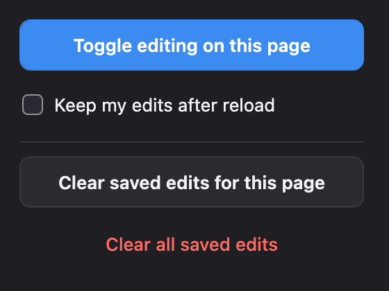

# Zen Edit Mode

Click any webpage and edit its text in place. A tiny add-on for [Zen Browser](https://zen-browser.app) and Firefox, with an optional setting to keep your edits after the page reloads.

Handy for mocking up copy changes, trying out headlines, cleaning a page before a screenshot, or just having fun with the news.

<p align="center">
  
</p>

## Features

- **Edit any page.** Turn on edit mode and click anywhere to type, delete or paste.
- **Keyboard shortcut.** Press `Alt+Shift+E` to toggle editing without opening the popup.
- **Keep edits (optional).** Your edited version comes back when you reopen the page.
- **Clear saved edits** for the current page or for every page.
- **Light and dark popup** that follows your system theme.

## Install

### From a release (recommended)

1. Download the latest `.xpi` from [Releases](https://github.com/Rijinjoel/zen-edit-mode/releases). It is signed by Mozilla.
2. In Zen, open `about:addons`, click the gear icon, then **Install Add-on From File…**.
3. Pick the `.xpi` and click **Add**.
4. Pin the button: click the extensions (puzzle) icon and pin **Edit Mode**.

### From source (temporary)

1. Download or clone this repo.
2. In Zen, open `about:debugging#/runtime/this-firefox`.
3. Click **Load Temporary Add-on…** and choose `manifest.json`.
4. Pin the button: click the extensions (puzzle) icon and pin **Edit Mode**.

A temporary add-on is removed when the browser restarts.

## Signing your own build

Zen and Firefox only keep add-ons that Mozilla has signed. You can sign this one for free as an unlisted (private) add-on. You need [Node.js](https://nodejs.org) installed.

### One-time setup

1. **Use your own add-on ID** (only if you forked this repo). In `manifest.json`, change `"id": "edit-mode@local"` to something unique, such as `"zen-edit-mode@yourname"`. Mozilla ties an ID to the first account that signs it, and it can't be changed afterwards.
2. **Create a Mozilla developer account.** Go to [addons.mozilla.org](https://addons.mozilla.org), click **Log in**, then open the [Developer Hub](https://addons.mozilla.org/developers/) and accept the developer agreement.
3. **Get your API keys.** Open [addons.mozilla.org/developers/addon/api/key](https://addons.mozilla.org/developers/addon/api/key/) and click **Generate new credentials**. Copy both values:
   - **JWT issuer** is your API key (looks like `user:12345678:123`).
   - **JWT secret** is a long random string. Keep it private.

### Sign it

1. Open Terminal in the repo folder:

   ```bash
   cd path/to/zen-edit-mode
   ```

2. Give web-ext your keys, replacing the placeholders. This keeps them out of the signing command:

   ```bash
   export WEB_EXT_API_KEY="user:12345678:123" WEB_EXT_API_SECRET="your-jwt-secret"
   ```

3. Sign:

   ```bash
   npx web-ext sign --channel=unlisted
   ```

   If it asks to install `web-ext`, type `y`. It uploads the add-on and waits for Mozilla's automatic review, which usually takes a few minutes. Keep the window open until it prints `Signed xpi downloaded`.

4. Clear the keys from your shell when it's done:

   ```bash
   unset WEB_EXT_API_KEY WEB_EXT_API_SECRET
   ```

### Install the signed file

1. If you loaded the temporary version, open `about:debugging#/runtime/this-firefox` and click **Remove** on it.
2. Open `about:addons`, click the gear icon, then **Install Add-on From File…**.
3. Pick the `.xpi` inside the `web-ext-artifacts` folder and click **Add**.

It now stays installed after restarts.

### Signing a new version

Mozilla refuses a version number it has already signed. Raise `"version"` in `manifest.json` (for example `1.4` to `1.5`), then repeat **Sign it** and **Install the signed file**.

## Usage

Click the **Edit Mode** toolbar button to open the popup:

| Control | What it does |
| --- | --- |
| **Toggle editing on this page** | Turns editing on or off. The button shows **ON** while editing. |
| **Keep my edits after reload** | Saves your edits and restores them when you reopen the page. Zen asks for access to all websites the first time. |
| **Clear saved edits for this page** | Deletes this page's saved version and reloads the original. |
| **Clear all saved edits** | Deletes every saved page. |

To change the shortcut, go to `about:addons`, click the gear icon, then **Manage Extension Shortcuts**.

## How it works

Edit mode switches on the browser's built-in [`document.designMode`](https://developer.mozilla.org/docs/Web/API/Document/designMode), which makes the whole page editable.

When **Keep my edits** is on, the add-on saves the page's content half a second after you stop typing. It puts the saved content back when you open the page again. Pages are matched by their address, ignoring anything after `#`.

Everything is stored locally in your browser. Nothing is sent anywhere.

## Limitations

- Edits are only visible to you, in your browser. The real website doesn't change.
- Sites that keep redrawing themselves with JavaScript (Gmail, X, most web apps) may overwrite restored edits or stop working properly after a restore. Mostly static pages work best.
- Browser pages such as `about:` pages and addons.mozilla.org can't be edited.

## Files

| File | Purpose |
| --- | --- |
| `manifest.json` | Add-on name, permissions and the shortcut |
| `background.js` | Turns editing on and off and sets the badge |
| `content.js` | Saves and restores edits on each page |
| `popup.html`, `popup.js` | The toolbar popup |

## License

MIT
